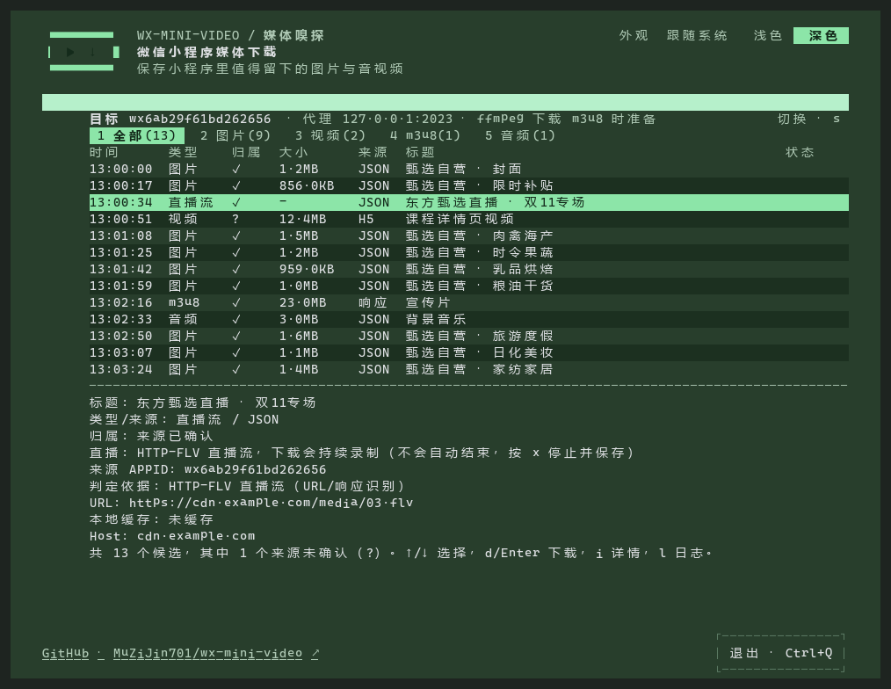
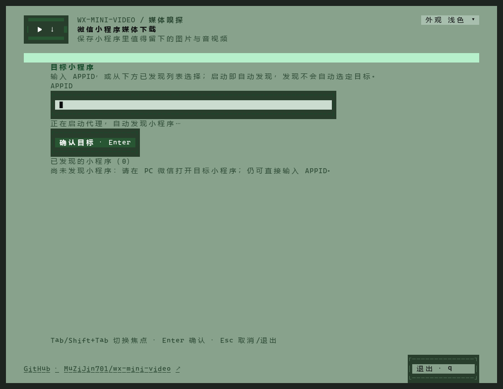
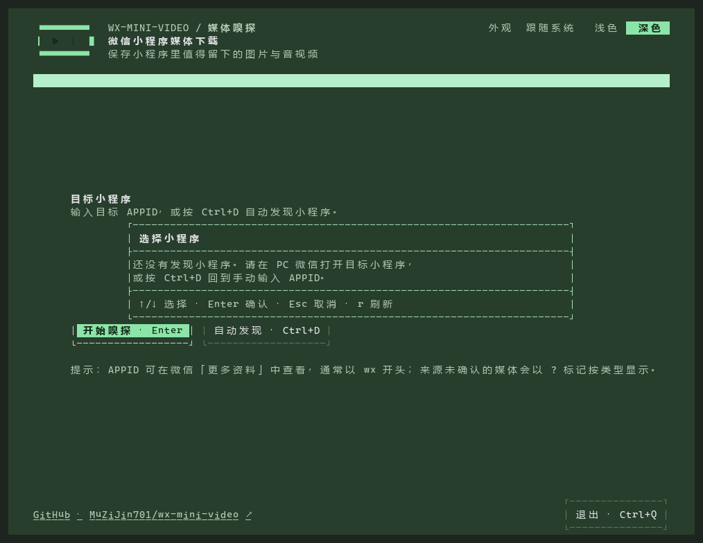
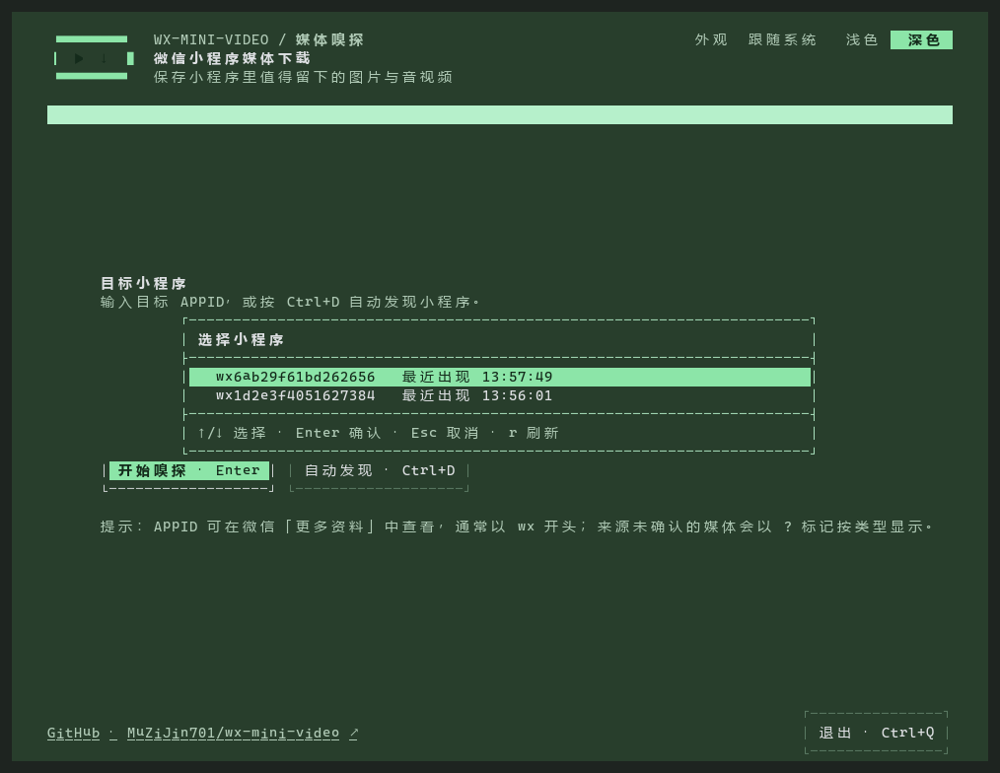
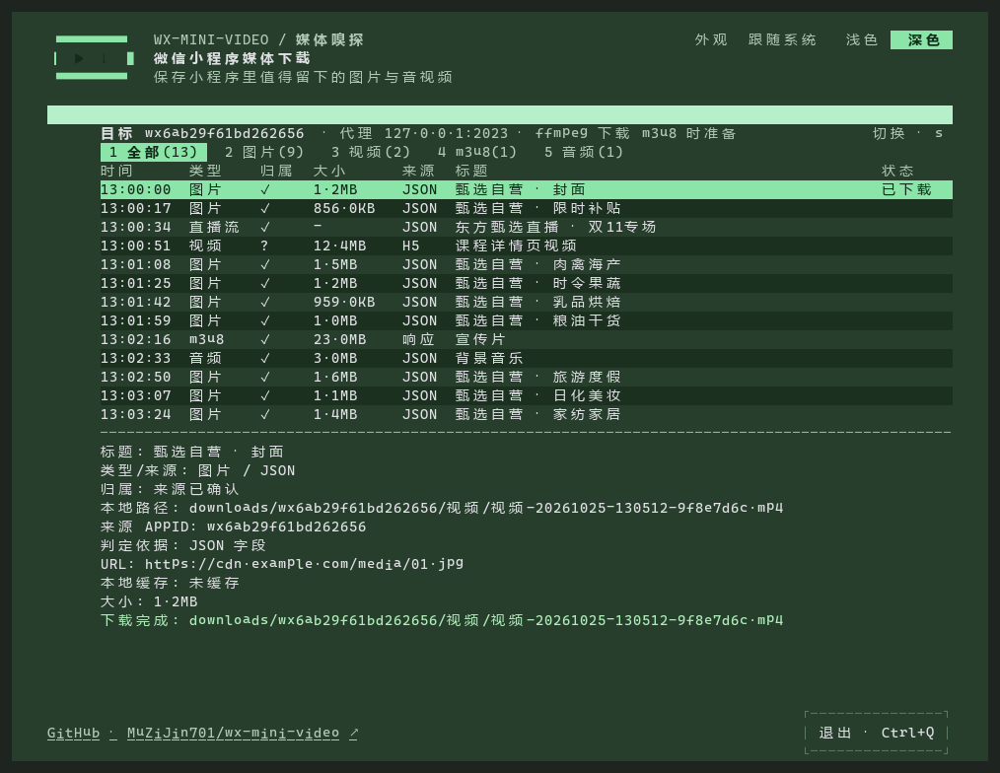

# 微信小程序媒体下载器

[English](README.en.md)

面向 Windows 的 TUI 工具，用于嗅探并下载 PC 微信小程序加载的图片、直链视频、直链音频和 m3u8 媒体。

支持图片：`jpg`、`png`、`webp`、`gif`、`bmp`、`avif`  
支持视频：`mp4`、`webm`、`mov`、`m3u8`

支持直链音频：`mp3`、`m4a`、`aac`、`wav`、`ogg`、`flac`、`opus`、`amr`。按响应 Content-Type 或 URL 后缀识别，直接保存原文件，不转码，也不从视频中提取音轨。

## 界面预览

选定小程序，浏览媒体，按键下载。手动输入目标 AppID 或使用小程序发现，再按分类查看候选资源；按 `d` 或 `Enter` 保存，按 `o` 打开下载目录。



<details open>
<summary>完整使用流程：从选择目标到下载完成</summary>

**1. 输入目标 AppID**

已知 AppID 时直接输入，小程序名称可选；也可以按 `Ctrl+D` 切换到小程序发现。



**2. 开始小程序发现**

在 PC 微信中打开目标小程序，让工具观察其网络活动。



**3. 选择发现的目标**

用 `↑/↓` 选择 AppID，按 `Enter` 进入名称补填界面并确认；随后重新打开目标内容，开始媒体嗅探。



**4. 下载并查看结果**

在媒体列表中选择候选资源，按 `d` 或 `Enter` 下载，完成后按 `o` 打开下载目录。下图展示图片下载完成的状态。



</details>

[下载最新版本](https://github.com/MuZiJin701/wx-mini-video/releases/latest) · [查看使用步骤](#使用)

## 下载

从 [GitHub Releases 最新版本](https://github.com/MuZiJin701/wx-mini-video/releases/latest)下载，不要从源码仓库的 `dist/` 目录取包：

- `wx-mini-video-windows-amd64.zip`

解压后会看到：

- `wx-mini-video.exe`
- `wx-mini-video.yaml`
- `README.md`

基础包不内置 ffmpeg。首次下载 `m3u8` 时，如果没有配置 `download.ffmpeg` 的本地完整路径，程序会下载并校验固定版本的受管 `ffmpeg.exe` 到下载目录；短暂网络或服务器错误会自动重试最多三次，不会使用系统 `PATH` 中的 ffmpeg。

### v0.1.7（2026-10-12）

统一包含目标 AppID 严格过滤、小程序发现与名称补填、`Ctrl+D` 切换入口、Windows Terminal 优先启动与 UAC 提权，以及直链音频识别和下载。此版本合并当天的 v0.1.4、v0.1.5、v0.1.6 发布，完整说明见 [CHANGELOG.md](CHANGELOG.md)。升级时解压新版包，替换 exe；保留已有配置和 `downloads/` 数据。

## 使用

1. 双击 `wx-mini-video.exe`。
2. 如果出现 Windows 管理员权限（UAC）提示，选择“是”。程序优先在 Windows Terminal 中打开；已经在管理员 Terminal 中运行时直接使用当前窗口。
3. 手动输入目标 AppID（名称可选），或按 `Ctrl+D` 启动小程序发现。
4. 使用发现时，在 PC 微信中打开目标小程序，用 `↑/↓` 选择发现的 AppID，按 `Enter` 进入名称补填界面，再按 `Enter` 确认。名称无法自动取得时显示“名称未识别”；即使只发现一个小程序也需要选择。
5. 确认目标后，重新打开目标图片或播放视频、音频。发现期间只登记小程序标识，不收集媒体或生成媒体缓存；已知 AppID 可以手动输入后直接嗅探。
6. 选中资源后按 `d` 或 `Enter` 下载。
7. 需要核对资源时按 `i` 查看完整 URL、来源 URL、请求头摘要和本地缓存路径。
8. 按 `q` 退出，程序会恢复启动前的系统代理。

资源列表默认显示“视频”分类，可用 `Tab` 或数字键切换到“全部 / 图片 / 视频 / m3u8 / 音频”；按 `5` 查看音频，按 `1` 查看全部。直链音频沿用断点续传和历史记录，不需要 ffmpeg。

按 `s` 返回目标选择界面；可从发现列表选另一个目标，或按 `Ctrl+D` 手动输入。切换会清空旧候选和进度，保留已下载文件、历史、部分下载和已有缓存。下载进行中暂不允许切换。

未安装 Windows Terminal 或 `wt.exe` 不可用时，程序保留当前控制台。若中文显示缺失，请安装并使用 Windows Terminal，或为传统控制台选择支持中文的字体。取消 UAC 会停止启动；启动失败会显示错误对话框。程序不会自动安装 Terminal 或更改系统默认终端。

### AppID 在哪里查找

在手机微信打开小程序，点右上角 `…`，进入小程序名称对应的介绍页；再点介绍页右上角 `…` →“更多资料”，查看 AppID。不同微信版本的入口文字可能不同。小程序管理员也可以在微信公众平台的“设置”→“基本设置 / 开发设置”中查看 AppID。找不到时，可直接使用本工具的 `Ctrl+D` 小程序发现。

下载文件、缓存、日志、证书和受管 ffmpeg 默认保存在程序旁边的 `downloads` 目录；移动解压后的程序目录即可一并移动这些运行时数据。设置 `download.dir` 后使用该显式目录。

直链下载会先写入同名 `.part` 文件，网络中断后再次下载会尝试从已有部分继续。成功完成的下载会追加记录到 `downloads/history.jsonl`。

## 快捷键

| 按键 | 功能 |
| --- | --- |
| `↑/↓`、`k/j` | 选择资源 |
| `Tab`、`Shift+Tab` | 切换分类 |
| `1/2/3/4/5` | 切换到全部、图片、视频、m3u8、音频 |
| `Ctrl+D` | 在 AppID 输入界面与小程序发现界面之间切换 |
| `d`、`Enter` | 下载选中资源 |
| `i` | 显示或隐藏选中资源详情 |
| `c` | 清空资源列表 |
| `s` | 返回目标选择界面，下载中不可切换 |
| `r` | 刷新列表 |
| `o` | 打开下载目录 |
| `l` | 显示或隐藏日志 |
| `PgUp/PgDn` | 翻阅日志 |
| `q` | 退出并恢复系统代理 |

## 重要说明

- 本工具通过本地 HTTPS 代理识别图片、视频、音频和 m3u8 媒体。
- 首次运行需要安装本地根证书，Windows 可能弹出权限确认。
- AppID 用于过滤请求来源：仅接受 HTTPS `servicewechat.com/<AppID>/<版本>/page-frame.html` 格式的 `Referer`，并完整匹配目标 AppID。其他小程序以及来源信息缺失、格式非法的媒体均不会进入列表，也不会触发媒体缓存或回补请求；正常网络转发继续。
- 来自已匹配目标 JSON 接口的图片、直链视频和直链音频链接可进入列表；JSON 中的 m3u8 链接继续跳过，需实际观察到匹配来源的播放列表响应。音频与其他媒体使用相同的 AppID 来源过滤规则。
- 严格过滤可能漏掉没有来源信息的目标媒体。小程序发现只覆盖代理实际观察到的小程序，不保证所有 AppID 都能自动取得名称；名称可手动补填且不参与过滤。
- 小程序一次可能加载很多媒体，建议先按 `c` 清空，再操作目标内容。
- 如果程序异常退出后网络异常，重新以管理员身份运行本工具，再按 `q` 正常退出即可恢复代理。

## 常见问题

### 打不开小程序或提示网络错误

可能是系统代理没有恢复。重新运行 `wx-mini-video.exe`，进入界面后按 `q` 退出。

### 证书安装失败

请确认已“以管理员身份运行”。如果仍失败，可以手动安装下载目录里的 `WxMiniVideoRoot.cer` 到“受信任的根证书颁发机构”。

代理启动后，也可以访问：

```text
http://127.0.0.1:2023/cert
```

### m3u8 下载很慢

长视频通常包含大量分片，耗时会比普通 mp4 更久。程序会并发下载分片并显示进度。如果失败较多，可以把配置里的 `segmentConcurrency` 从 `6` 改成 `4`。

### m3u8 合并失败

完整 ffmpeg 输出写入 `下载目录\.ffmpeg\<候选ID>.log`，界面错误会给出该路径。日志不会写入已捕获的请求头值。

### 没有识别到目标资源

确认目标 AppID，重新打开目标图片或播放目标视频、音频，按 `1` 查看全部或 `5` 查看音频。严格过滤会排除没有匹配来源信息的请求；共用 CDN 域名不会扩大范围。部分小程序资源可能不是支持的图片、视频、音频或 m3u8 格式，暂时无法识别。

### 没有发现目标小程序

确认代理已启动，在 PC 微信重新打开小程序以产生网络请求，也可按 `r` 刷新或重试启动。仍未发现时按 `Ctrl+D` 手动输入 AppID；手动入口与发现入口使用相同过滤规则，不能绕过来源缺失。

## 配置

配置文件是 `wx-mini-video.yaml`。常用项：

```yaml
download:
  dir: ""
  ffmpeg: ""
  mode: "auto"
  segmentConcurrency: 6
  segmentRetries: 3
  keepSegments: false

proxy:
  system: true
  hostname: "127.0.0.1"
  port: 2023
  skipInstallRootCert: false

target:
  appID: ""
  name: ""
```

一般不需要修改配置。若已自行安装 ffmpeg，可将 `download.ffmpeg` 设置为该 `ffmpeg.exe` 的完整路径；留空时使用受管 ffmpeg。

## 开发构建

```powershell
go test -count=1 ./...
go vet ./...
build\build.bat windows
```

构建产物：

- `dist\wx-mini-video-windows-amd64\`
- `dist\wx-mini-video-windows-amd64.zip`

`dist\` 是本机构建目录，不提交到 Git。对外分发时，把 zip 上传到 GitHub Releases。
构建脚本会自动运行 `build\verify-package.ps1`，确保 zip 只包含 `README.md`、`wx-mini-video.exe` 和 `wx-mini-video.yaml`。

项目维护文档：

- `AGENTS.md`：agent 的项目规则、文档入口和验证要求
- `GLOSSARY.md`：项目领域术语
- `CHANGELOG.md`：版本变更与合并发布说明
- `wx-mini-video-knowledge.md`：实现、配置、分发和排障知识
- `docs/adr/`：按需记录的长期架构决策
- `docs/agents/`：工程技能的 issue、标签和领域文档约定
- `docs/appid-filtering-requirements.md`：已实现的 AppID 过滤规格快照及后续扩展说明
- `docs/archive/`：历史文档与已完成计划

## 免责声明

本项目仅用于技术交流和学习研究。请遵守法律法规，不要用于任何非法用途。
